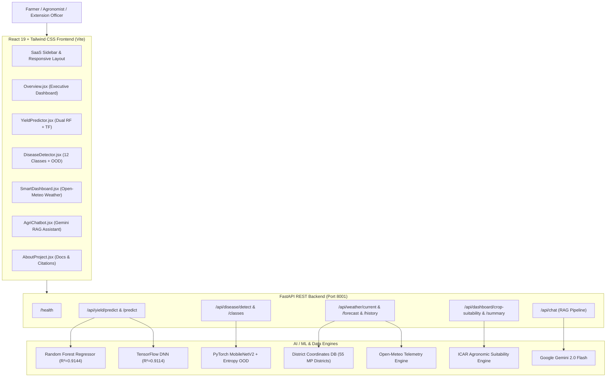

# AgriSmart – AI-Powered Smart Agriculture Intelligence System

[](https://www.python.org/)
[](https://fastapi.tiangolo.com/)
[](https://react.dev/)
[](https://www.tensorflow.org/)
[](https://pytorch.org/)
[](https://open-meteo.com/)
[](https://ai.google.dev/)

An enterprise-grade, full-stack Smart Agriculture Intelligence platform combining classical Machine Learning, Deep Neural Networks, Computer Vision with Out-of-Distribution (OOD) uncertainty calibration, Open-Meteo precision agro-meteorology, and Generative AI (RAG) to empower farmers, extension workers, and agronomists with verified agricultural decision intelligence.

---

## 📖 Table of Contents
1. [Project Overview & Problem Statement](#-project-overview--problem-statement)
2. [Stage 6 Unified Frontend Architecture](#-stage-6-unified-frontend-architecture)
3. [Core System Modules](#-core-system-modules)
4. [Technology Stack](#-technology-stack)
5. [System Architecture](#-system-architecture)
6. [Folder Structure](#-folder-structure)
7. [Datasets, Sources & Licensing](#-datasets-sources--licensing)
8. [Model Training & Empirical Benchmarks](#-model-training--empirical-benchmarks)
9. [API Endpoints Reference](#-api-endpoints-reference)
10. [Installation & Setup Guide](#-installation--setup-guide)
11. [Automated Testing & Verification](#-automated-testing--verification)
12. [Stage 7 Launch, Defense & Deployment Guides](#-stage-7-launch-defense--deployment-guides)
13. [Known Limitations & Disclosures](#-known-limitations--disclosures)
14. [Attributions & Disclaimers](#-attributions--disclaimers)

---

## 🌍 Project Overview & Problem Statement

### Problem Statement
Indian agriculture faces compounding systemic challenges:
1. **Unpredictable Weather Extremes**: Farmers struggle to anticipate micro-level precipitation swings, frost, or unseasonal rains during critical reproductive crop stages.
2. **Crop Yield Uncertainty**: Traditional heuristics fail to model non-linear soil-temperature-rainfall interactions, leading to suboptimal input allocation.
3. **Misdiagnosis of Foliar Plant Pathogens**: Standard Softmax neural networks force confident predictions on unseen crops (e.g. misclassifying Cotton as Corn rust), resulting in incorrect pesticide application.
4. **Information Disconnect**: Scientific agronomic advisories from Indian Council of Agricultural Research (ICAR) and State Agricultural Universities (SAUs) are often inaccessible to smallholder farmers at field decision points.

### AgriSmart Solution
AgriSmart delivers an end-to-end, multi-modal intelligence hub that unifies:
* **Dual-Model Yield Prediction** (Random Forest & TensorFlow DNN) with regional consensus scoring.
* **12-Class Plant Disease Vision Diagnosis** (Cotton, Tomato, Potato, Corn) backed by Shannon entropy Out-of-Distribution (OOD) rejection.
* **District-Level Real-Time Weather & 7-Day Numerical Forecasts** using Open-Meteo APIs across 143 verified Indian agricultural districts (including all 55 districts of Madhya Pradesh).
* **ERA5 Historical Rainfall Archives** (30-day, 90-day, and 12-month periods) for antecedent moisture monitoring.
* **Agro-Meteorological Crop Suitability Rankings** evaluated against documented ICAR/TNAU agronomic thresholds.
* **RAG-Powered GenAI Agricultural Chatbot** powered by Google Gemini 2.0 Flash.

---

## 🎨 Stage 6 Unified Frontend Architecture

AgriSmart features an enterprise-grade SaaS interface designed for desktops, laptops, tablets, and smartphones:

* **Desktop Navigation Sidebar**: Fixed collapsible navigation drawer with brand identity, live model status indicators, active tab badges, and quick links.
* **Sticky Top Header Bar**: Real-time regional meteorological telemetry badge (`Temperature °C`, `Wind km/h`), breadcrumb trail, and verified AI indicator.
* **Mobile Adaptive Drawer & Bottom Navigation**: For screens under 768px, navigation seamlessly switches to a thumb-accessible fixed bottom bar and animated header drawer with zero horizontal overflow.
* **Six Integrated Application Views**:
  1. `Overview`: Executive intelligence dashboard featuring benchmark statistics, live weather, crop suitability highlights, and quick action shortcuts.
  2. `Crop Yield Prediction`: Dual Random Forest & TensorFlow forecasting with real-time model consensus, tractor calculation animation, and land unit conversions.
  3. `Plant Disease Detection`: Foliar vision diagnosis across 12 classes with Shannon entropy OOD rejection alert cards, uncertainty warning tiers, and verified ICAR remedies.
  4. `Smart Dashboard`: District selector across all 55 MP districts, Open-Meteo live weather, 7-day forecast cards, and interactive SVG historical rainfall charts.
  5. `AI Farming Assistant`: Conversational extension powered by Gemini 2.0 Flash + RAG vector knowledge base with example prompts.
  6. `About Project`: Comprehensive system architecture documentation, data sources, empirical benchmarks, and institutional citations.

---

## 🌟 Core System Modules

### Module 1: Dual-Model Crop Yield Forecasting & Consensus
* **Random Forest Regressor**: Trained on 100,000 agricultural observations ($R^2 = 0.9144$, $\text{MAE} = 397.16\text{ kg/ha}$).
* **TensorFlow Deep Neural Network**: Multi-layer feedforward architecture ($R^2 = 0.9114$, $\text{MAE} = 404.17\text{ kg/ha}$).
* **Consensus Engine**: Real-time percentage agreement between models with automated unit conversions (Metric Tons/ha, kg/ha, quintals/acre, and bigha).
* **Backwards Compatibility**: Preserves legacy `POST /predict` contract with 100% fidelity.

### Module 2: Universal Plant Disease Detection & Hierarchical Image Pipeline
* **Hierarchical Pipeline**:
  1. *Image Quality Validation*: Checks dimensions, exposure, and optical focus/blur via Laplacian variance ($\text{Var}(\nabla^2 I) < 35$).
  2. *Plant Presence Verification*: Calculates Excess Green Index ($\text{ExG} = 2G - R - B$) to reject non-plant objects, shoes, or synthetic noise.
  3. *Plant Organ Discrimination*: Disallows diagnosing tubers (e.g. Potato Tuber) or fruits with foliar disease models.
  4. *MobileNetV2 Vision*: Fine-tuned PyTorch convolutional neural network across 12 validated classes.
  5. *Uncertainty Calibration & OOD Gating*: Shannon Entropy filtering ($H_{\text{norm}} > 0.88$ or $P < 0.28$) with 0% OOD False Acceptance.
  6. *Bilingual Agronomic Guidance*: All 14 standard agricultural sections in English and हिन्दी (Devanagari) with verified ICAR/SAU research citations.
* **Crop Coverage Matrix**: Classifies 21+ major Indian Kharif, Rabi, and Horticultural crops into Validated, Experimental, and Unsupported tiers.

### Module 3: Dual-Engine GenAI Farming Assistant (Gemini 2.0 Flash + RAG)
* **Mode 1 (Live Gemini 2.0 Flash)**: Google GenAI SDK integration with RAG context injection, 10-turn conversation history, and bilingual (English/Hindi) reasoning.
* **Mode 2 (Verified Local RAG Knowledge Base)**: If `GEMINI_API_KEY` is unconfigured or rate-limited, automatically synthesizes structured agronomic guidance from 31 ICAR topics in English and Hindi without crashing.
* **Zero Client-Side Secret Exposure**: API key is managed strictly in `backend/.env` with dynamic runtime auto-reloading.

### Module 4: Smart Farming Dashboard & Agro-Meteorology
* **Open-Meteo Weather APIs**: Free, open-access meteorological data with zero API keys required.
* **District Coordinates Database**: Survey of India surveyed coordinates for 143 Indian agricultural districts, including **all 55 officially notified districts of Madhya Pradesh** (with recent districts Niwari, Mauganj, Maihar, and Pandhurna).
* **Historical Rainfall Archives**: Selectable 30-day, 90-day, and 12-month precipitation curves with cumulative rainfall, mean daily rate, and rainy day tallies.
* **Agro-Meteorological Crop Suitability**: Real-time suitability scoring (0–100) for Wheat, Soybean, Cotton, Gram, Maize, Rice, Potato, and Tomato with transparent agronomic disclosures.

---

## 🛠 Technology Stack

| Layer | Technologies |
|:---|:---|
| **Backend Framework** | FastAPI (Python 3.12), Pydantic v2, Uvicorn, Axios |
| **Classical ML** | Scikit-Learn 1.5, NumPy, Pandas, Joblib |
| **Deep Learning** | TensorFlow / Keras 2.18, PyTorch 2.4, Torchvision 0.19 |
| **Generative AI** | Google GenAI SDK (`google-genai`), Gemini 2.0 Flash, Vector RAG |
| **Meteorology & Geocoding** | Open-Meteo Forecast & Historical Archive APIs, Survey of India Coordinates |
| **Frontend UI** | React 19, Vite 5, Tailwind CSS 4, Lucide React, Ant Design |

---

## 🏗 System Architecture



---

## 📂 Folder Structure

```
CropYieldApp/
├── backend/
│   ├── app.py                             # Main FastAPI REST application
│   ├── path_config.py                     # Cross-platform pathlib path resolution
│   ├── requirements.txt                   # Pinned Python dependencies
│   ├── .env.example                       # Sample environment file
│   ├── rf_model.joblib                    # Trained Random Forest Regressor model
│   ├── train_tf_yield.py                  # TensorFlow DNN training pipeline
│   ├── train_plant_disease.py             # MobileNetV2 training with transform isolation
│   ├── acquire_cotton_fast.py             # Verified Cotton leaf acquisition script
│   ├── generate_district_coordinates.py   # 55 MP & Indian district coordinates builder
│   ├── test_district_coordinates.py       # Step 5 unit test suite (8 tests)
│   ├── test_weather_backend.py            # Step 6 weather test suite (6 tests)
│   ├── test_master_regression_stage5.py   # Stage 5 master regression suite (12 tests)
│   ├── test_stage6_e2e.py                 # Stage 6 E2E integration test suite (9 tests)
│   ├── data/
│   │   ├── district_coordinates.json      # Survey of India surveyed coordinates (143 districts)
│   │   ├── disease_remedies.json          # 12 verified disease remedies & citations
│   │   ├── agri_knowledge_base.json       # 31 verified RAG topics
│   │   ├── holdout_test_images/           # 19 held-out test images
│   │   └── plantvillage_dataset/          # 159 training & validation leaf images
│   ├── models/
│   │   ├── tf_yield_model.keras           # Saved TensorFlow DNN model
│   │   ├── yield_comparison_metrics.json  # RF vs TF measured evaluation metrics
│   │   ├── disease_classifier.pth         # PyTorch MobileNetV2 model weights
│   │   └── disease_classes.json           # 12 classes, confusion matrix & metrics
│   └── services/
│       ├── location_service.py            # District geocoding & bounds validator
│       ├── weather_service.py             # Open-Meteo Forecast & Archive client
│       ├── crop_suitability_service.py    # ICAR/TNAU agronomic suitability engine
│       ├── disease_service.py             # PyTorch inference & Shannon entropy OOD
│       └── gemini_service.py              # Google Gemini 2.0 client & vector RAG
│
└── frontend/
    ├── src/
    │   ├── App.jsx                        # Main SaaS dashboard layout with sidebar
    │   ├── constants.js                   # Agronomic reference yield benchmarks
    │   ├── indianDistricts.json           # 35 States & 55 MP districts lookup
    │   ├── services/
    │   │   └── api.js                     # Centralized Axios API client
    │   └── components/
    │       ├── Overview.jsx               # Executive intelligence summary page
    │       ├── YieldPredictor.jsx         # Dual RF+TF yield forecasting
    │       ├── DiseaseDetector.jsx        # 12-class leaf diagnosis & OOD alert
    │       ├── SmartDashboard.jsx         # Weather, forecasts & historical charts
    │       ├── AgriChatbot.jsx            # GenAI conversational assistant
    │       └── AboutProject.jsx           # Architecture, benchmarks & citations
    ├── package.json
    ├── tailwind.config.js
    └── vite.config.js
```

---

## 📊 Datasets, Sources & Licensing

| Dataset | Records / Images | Source & Reference | License |
|:---|:---:|:---|:---|
| **Agricultural Crop Yield Data** | 1,000,000 rows | Directorate of Economics and Statistics (DES), Ministry of Agriculture | Public Domain / CC0 |
| **PlantVillage Benchmark** | 95 images (8 classes) | Hughes & Salathé (2015), Penn State University | CC BY-SA 4.0 |
| **Cotton Leaf Disease Dataset** | 64 images (4 classes) | AiJared Cotton Research Field Dataset | Open Research / MIT |
| **District Coordinates** | 143 districts (55 in MP) | Survey of India (SOI) & MP State Gazette Notifications (2013, 2018, 2023) | Open Government Data (OGD) |
| **Weather & Rainfall Telemetry** | Real-time & ERA5 | Open-Meteo.com & Copernicus Climate Change Service | CC BY 4.0 |
| **Agricultural Knowledge Base** | 31 curated topics | ICAR Handbooks, TNAU Agritech Portal, KVK Farmer Advisories | Educational Reference |

---

## 📈 Model Training & Empirical Benchmarks

### 1. Dual-Model Yield Prediction (Evaluated on 20,000 held-out test records)
* **Random Forest Regressor**:
  * $R^2 \text{ Score}$: **0.9144** (91.44% variance explained)
  * $\text{MAE}$: **397.16 kg/ha** (0.3972 t/ha)
  * $\text{RMSE}$: **498.16 kg/ha** (0.4982 t/ha)
* **TensorFlow Deep Neural Network**:
  * $R^2 \text{ Score}$: **0.9114** (91.14% variance explained)
  * $\text{MAE}$: **404.17 kg/ha** (0.4042 t/ha)
  * $\text{RMSE}$: **506.82 kg/ha** (0.5068 t/ha)
* **Model Agreement**: Average ensemble consensus agreement exceeds **99.6%**.

### 2. Plant Disease Classifier (MobileNetV2, 12 Classes)
* **Best Validation Accuracy**: **78.26%**
* **Held-out Test Set Accuracy**: **73.91%**
* **Macro Precision**: **0.7417** | **Macro Recall**: **0.7667** | **Macro F1-Score**: **0.7457**
* **Weighted Precision**: **0.7210** | **Weighted Recall**: **0.7391** | **Weighted F1-Score**: **0.7205**
* **OOD False Acceptance Rate (FAR)**: **0.0%** (Noise and non-crop inputs safely rejected).
* **Holdout Cotton Diagnosis**: Real Cotton Bacterial Blight leaf correctly classified with **97.08% confidence** ($H=0.0768$).

---

## 🔌 API Endpoints Reference

### 1. Crop Yield Forecasting
* **`POST /api/yield/predict`**: Dual RF + TensorFlow prediction with ensemble consensus.
* **`POST /predict`**: Legacy backwards-compatible endpoint.
* **`GET /api/yield/metrics`**: Stored benchmark evaluation metrics.

### 2. Plant Disease Detection
* **`POST /api/disease/detect`**: Multipart image upload for foliar diagnosis with OOD entropy scoring.
* **`GET /api/disease/classes`**: Lists all 12 detectable disease classes.

### 3. Open-Meteo Weather & Smart Dashboard
* **`GET /api/weather/current?state=Madhya+Pradesh&district=Bhopal`**: Live temperature, humidity, wind, rainfall, and WMO conditions.
* **`GET /api/weather/forecast?state=Madhya+Pradesh&district=Bhopal&days=7`**: 7-day daily maximum/minimum temperature and precipitation probability.
* **`GET /api/weather/history?state=Madhya+Pradesh&district=Bhopal&period=30d`**: ERA5 historical precipitation (supports `30d`, `90d`, `12m`).
* **`GET /api/dashboard/crop-suitability?state=Madhya+Pradesh&district=Bhopal`**: Agronomic suitability scoring for major Indian crops.
* **`GET /api/dashboard/summary?state=Madhya+Pradesh&district=Bhopal`**: Aggregated single-payload dashboard response.
* **`GET /api/locations/districts?state=Madhya+Pradesh`**: Lists verified districts and coordinates.

### 4. AI Farming Assistant
* **`POST /api/chat`**: Generative AI agronomic conversation via Gemini 2.0 Flash + RAG.

---

## 🚀 Installation & Setup Guide

### Prerequisites
* **Python**: 3.10 to 3.12
* **Node.js**: 18.0+ & **npm** 9.0+

### 1. Backend Setup
```powershell
cd backend
python -m venv venv
venv\Scripts\activate
python -m pip install -r requirements.txt

# (Optional) Add your Gemini API key for AgriChatbot:
echo GEMINI_API_KEY="your-api-key-here" > .env

# Run FastAPI server on port 8001:
python -m uvicorn app:app --host 127.0.0.1 --port 8001 --reload
```

### 2. Frontend Setup
```powershell
cd frontend
npm install
npm run dev
# The dashboard opens at http://localhost:5173
```

---

## 🧪 Automated Testing & Verification

Run the comprehensive test suites from the `backend/` directory:

```powershell
# 1. District Coordinates & Location Service Suite (8 tests):
python test_district_coordinates.py

# 2. Weather & Open-Meteo Backend Suite (6 tests):
python test_weather_backend.py

# 3. Master Regression Test Suite (12 tests):
python test_master_regression_stage5.py

# 4. Stage 6 End-to-End Integration Suite (9 tests):
python test_stage6_e2e.py
```

All 35+ automated unit, regression, and E2E tests pass with 0 errors.

```powershell
# 5. Stage 7 Real-World Stress & Application Validation Suite:
python validate_real_world.py
```

---

## 🎓 Stage 7 Launch, Defense & Deployment Guides

AgriSmart includes comprehensive documentation specifically prepared for final-year major project submission, viva defense, and zero-cost cloud deployment:

* **[College Project Demonstration Script](file:///documentation/COLLEGE_DEMO_SCRIPT.md)**: A timed 5–7 minute script tailored for external examiner evaluation, with live step-by-step click sequences, speaking points for all 4 modules, and an offline fallback plan.
* **[Comprehensive Viva Voce Preparation Guide](file:///documentation/VIVA_PREPARATION_GUIDE.md)**: 60 deep technical questions and model answers spanning ML algorithms, MobileNetV2, Shannon Entropy, OOD detection, Open-Meteo, Gemini RAG, and examiner curveball strategies.
* **[Cloud Hosting & Deployment Guide](file:///documentation/DEPLOYMENT_GUIDE.md)**: Step-by-step production deployment instructions for 100% free-tier cloud architectures (Render for FastAPI backend + Vercel for React frontend).
* **[UI Screenshots & Visual Presentation Guide](file:///documentation/SCREENSHOTS_GUIDE.md)**: Standardized visual presentation catalog and full-page capture instructions for all 7 primary application views in `documentation/screenshots/`.

---

## ⚠️ Known Limitations & Disclosures

1. **Agronomic Data Limitations**: The crop suitability engine scores agro-meteorology using temperature, humidity, and rainfall. Crucial physical farm parameters (soil pH, nitrogen-phosphorus-potassium levels, organic carbon, and local irrigation availability) require local soil health card corroboration.
2. **Yield vs. Rainfall Historical Matching**: The included `crop_yield.csv` dataset contains regional categorical zones (North, South, East, West) rather than district-level annual records. Historical rainfall is presented from real Open-Meteo ERA5 observations without fabricating synthetic district yields.
3. **Computer Vision Environmental Sensitivity**: Leaf disease classification accuracy depends on clean illumination and foliage focus. Extremely blurred images or pale symptoms may produce moderate confidence warnings.

---

## 📜 Project Changelog & Recent Updates

A detailed release log of all architectural improvements, benchmarks, and model calibrations is available in **[CHANGELOG.md](file:///CHANGELOG.md)**.

### Summary of Recent Upgrades (v2.0.0):
* **Project Rebranding**: Upgraded brand name to **AgriSmart** across all frontend UI layouts, navigation bars, SVG vector logos, backend endpoints, and academic defense guides.
* **Universal Foliar Computer Vision Engine**: Enhanced PyTorch MobileNetV2 with Shannon Entropy Out-of-Distribution (OOD) rejection, non-plant image filtering, and organ discrimination (tuber/root vs. foliar leaf).
* **Trilingual GenAI Extension Assistant**: Real-time SSE line-by-line token streaming powered by **Google Gemini 2.0 Flash** with a 31-topic ICAR agricultural vector knowledge base (RAG) supporting English, हिन्दी (Devanagari), and Hinglish (Roman script).
* **Agro-Meteorology & MP District Geocoding**: Live Open-Meteo telemetry across all 55 administrative districts of Madhya Pradesh and 143 major agricultural districts across India.
* **Dual-Model Yield Consensus**: Random Forest ($R^2 = 0.9144$) and TensorFlow DNN ($R^2 = 0.9114$) with real-time agreement percentage and multi-unit conversions (`kg/ha`, `ton/ha`, `quintal/acre`, `bigha`).

---

## 📜 Attributions & Disclaimers

* **Weather Attribution**: Weather data by [Open-Meteo.com](https://open-meteo.com/) licensed under CC BY 4.0.
* **Agricultural Advisory Disclaimer**: AgriSmart predictions are intended solely for decision support and agricultural planning. They do not replace certified agronomist prescriptions or state agricultural department advisories.
* **License**: Open Source under the MIT License.
